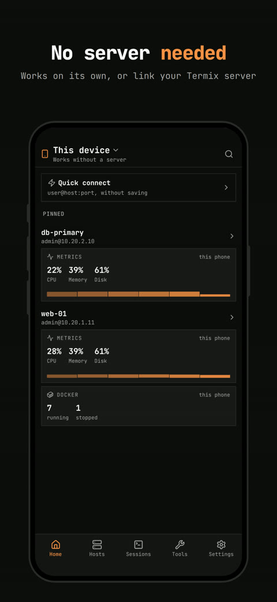
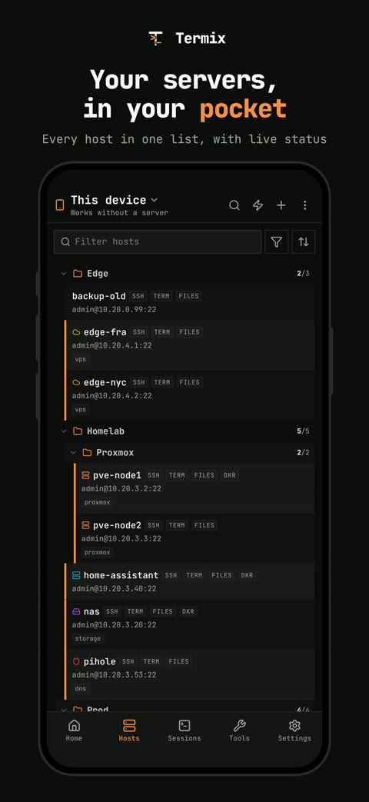
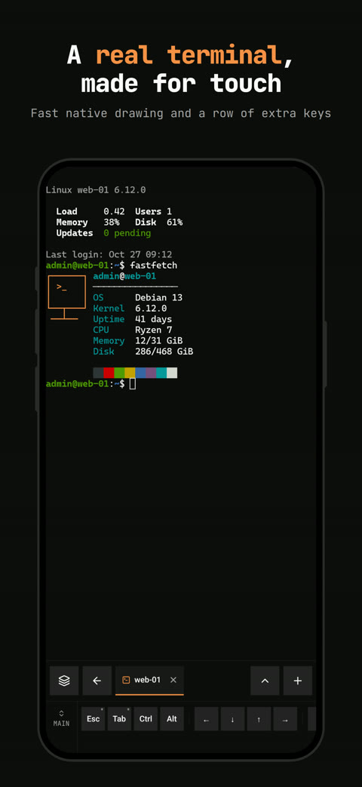
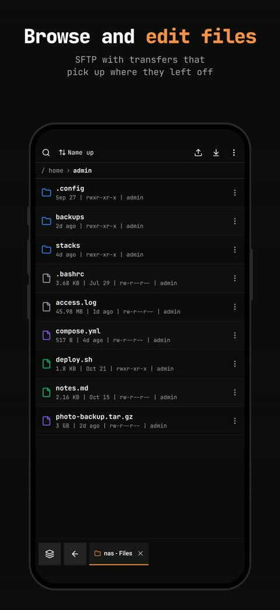
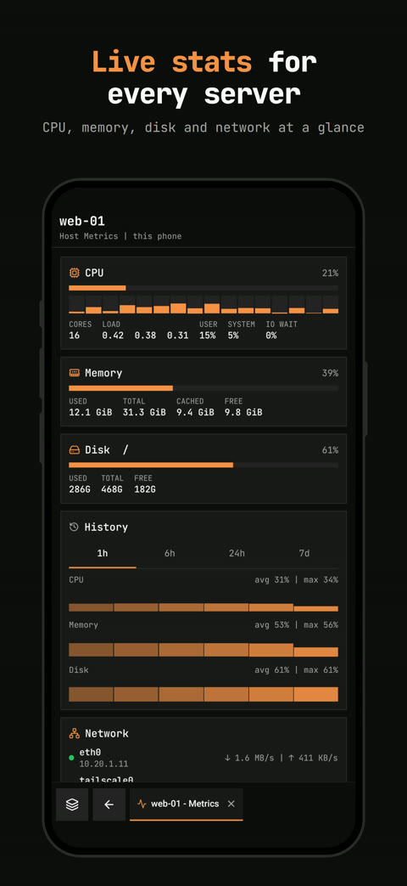
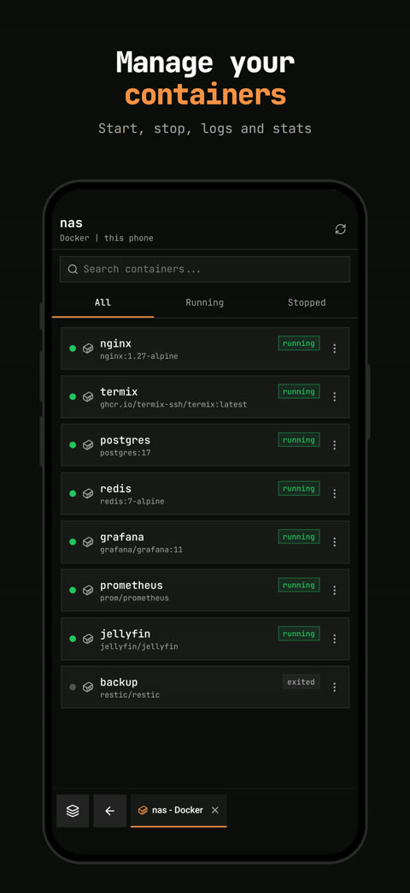
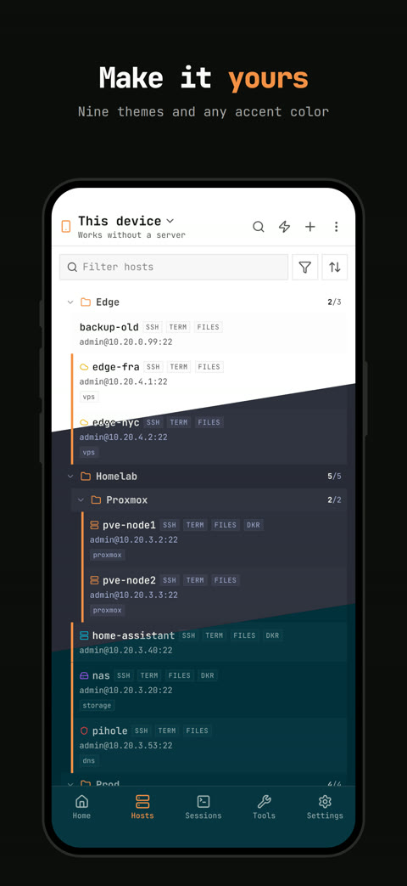
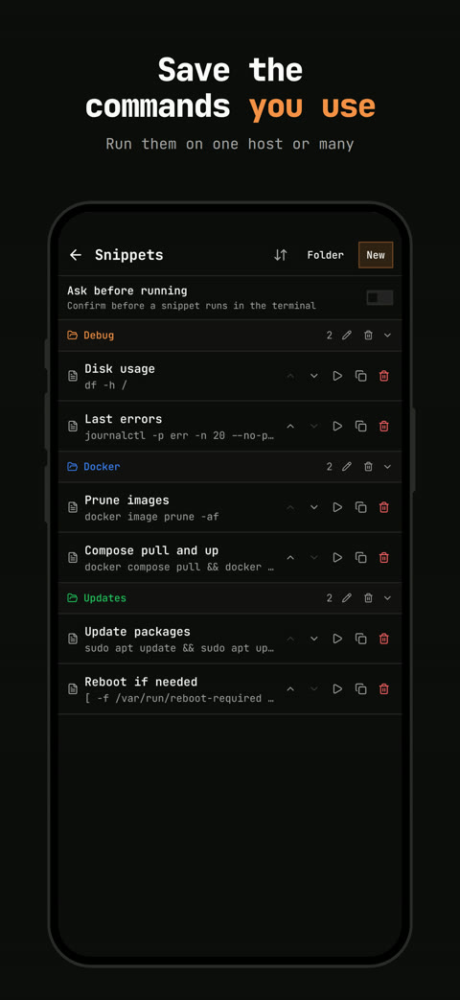
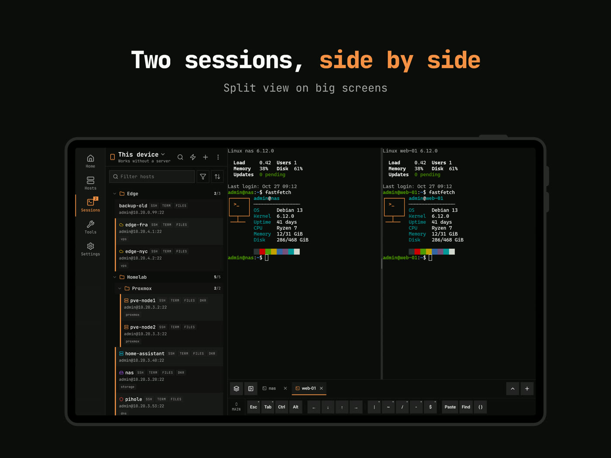

<h1>Termix Mobile</h1>

SSH client for phones and tablets, with or without a Termix server

  
  
  
  
  

  

 

## Overview

Termix Mobile is an SSH client for phones and tablets. It works on its own with no server, keeping hosts, logins and snippets in an encrypted database on the phone and connecting straight from it. Link one or more [Termix](https://github.com/Termix-SSH/Termix) servers to sync with them, reach hosts through them and use their plugins. See the [mobile app docs](https://docs.termix.site/mobile).

Try Termix at [demo.termix.site](https://demo.termix.site/). Any username and password works.

 

## Screenshots

 

## Features

- No server needed: hosts, logins and snippets are saved on the phone in an encrypted database. Export a backup locked with a passphrase, or delete it all in Settings.
- Servers: link more than one Termix server and switch between them while open tabs keep running. Each server keeps its own encrypted copy on the phone, synced both ways and in the background, so its hosts work offline too. Needs the Sync plugin on the server. Each host can connect from the phone, through the server or pick on its own.
- Terminal: a fast native terminal with smooth scrolling, selection, links and mouse support. Themes, fonts with ligatures and pinch to zoom, set globally or per host. Key rows in groups (Main, Nav, Symbols, Ctrl, tmux) with custom keys per host, find, tmux attach, password and sudo fill, history search and share links.
- Tabs: rename, drag, swipe and split them. Sessions keep running in the background on Android, tabs come back after the app is closed, and a dropped connection retries and keeps what you typed.
- File manager: browse, edit and move files over SFTP from the phone or through your server. Transfers with pause and resume, share files in from other apps, a code editor, previews and a files panel beside the terminal.
- Home: open sessions, quick connect, recent hosts and live cards for pinned hosts with metrics, Docker and services.
- Tools: host metrics with history, Docker containers, logs and compose stacks, systemd and OpenRC services with the journal, tunnels (local, remote and dynamic) and snippets that run on many hosts at once.
- Remote desktop: RDP, VNC and Telnet straight from the phone, or through your server.
- Hosts: folders with drag to reorder, select many, colors and icons, jump hosts, host defaults, import and export (Termix files and SSH config), QR sharing, Wake-on-LAN, host status and Tailscale.
- Keys: make Ed25519 and ECDSA keys, check keys and certificates as you type and convert PuTTY keys. OPKSSH, Step CA and Vault work through a linked server.
- Sign in: every login the server offers, including SSO, TOTP and passkeys, plus servers behind a reverse proxy (extra headers, Cloudflare tokens, basic auth, client certificates and proxy sign in pages).
- Server plugins: plugins with no phone version, like Homepage, Alerts and Proxmox, open inside the app with the same screens as the web app.
- Search: one palette for hosts, snippets, actions and settings.
- Tablets and keyboards: a sidebar and split view on wide screens, foldable support, resizable windows, keyboard shortcuts and mouse or trackpad support.
- Widgets: open a host, run a snippet or check metrics from the home screen on iOS and Android.
- App lock: Face ID, Touch ID or fingerprint with a PIN as backup, and the app hidden in the app switcher.
- Usage statistics: an anonymous daily report, off until you answer the question on first start. See [what is sent](https://docs.termix.site/privacy#mobile-app).

 

## Installation

Termix Mobile is available for [Android](https://docs.termix.site/install/apps/android) and [iOS](https://docs.termix.site/install/apps/ios) (iOS 16.4 or newer). To link a server, see [linking a server](https://docs.termix.site/mobile/linking).

 

## Sponsors

For a paid sponsor spot, email [mail@termix.site](mailto:mail@termix.site).

<!-- SPONSORS:START -->

 

&nbsp;&nbsp;&nbsp;

&nbsp;&nbsp;&nbsp;

&nbsp;&nbsp;&nbsp;

&nbsp;&nbsp;&nbsp;

&nbsp;&nbsp;&nbsp;

&nbsp;&nbsp;&nbsp;

<!-- SPONSORS:END -->

 

## Support

Bugs and ideas for the mobile app go in this repo: [report a bug](https://github.com/Termix-SSH/Mobile/issues/new?template=bug_report.yml) or [request a feature](https://github.com/Termix-SSH/Mobile/issues/new?template=feature_request.yml). Problems with the Termix server or a plugin go in the [Termix repo](https://github.com/Termix-SSH/Termix/issues/new/choose) or that plugin's repo. Not sure where it goes? Open it in Termix and it will be moved.

Add as much detail as you can, in English if possible.

For discussions and questions, join the [Discord](https://discord.gg/jVQGdvHDrf) server.

 

## License

Apache License 2.0. See [LICENSE](LICENSE).
